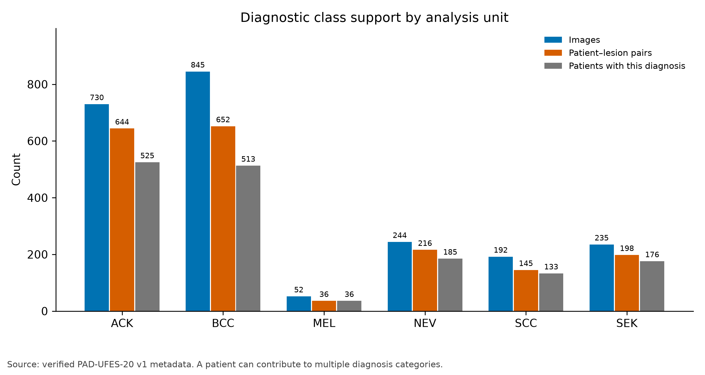
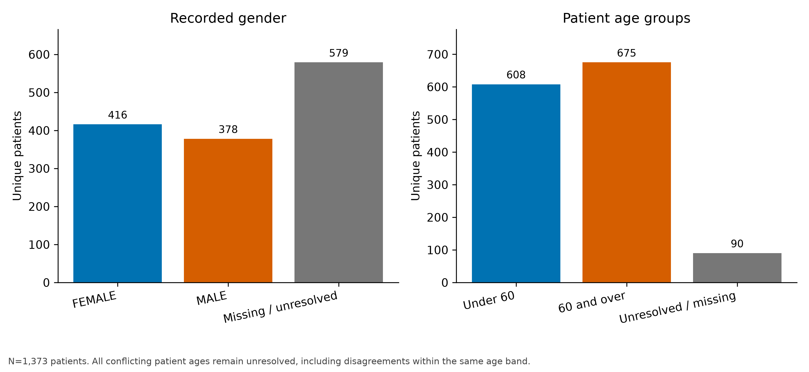
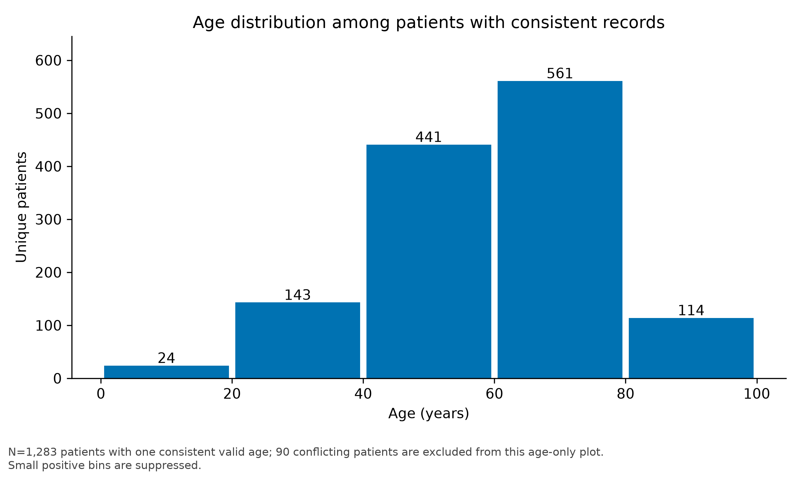
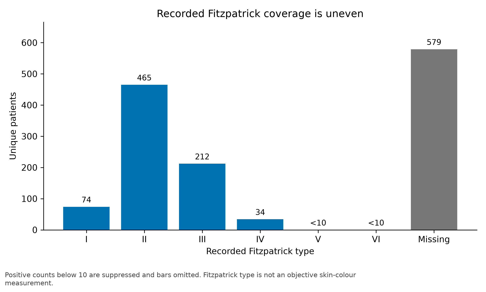
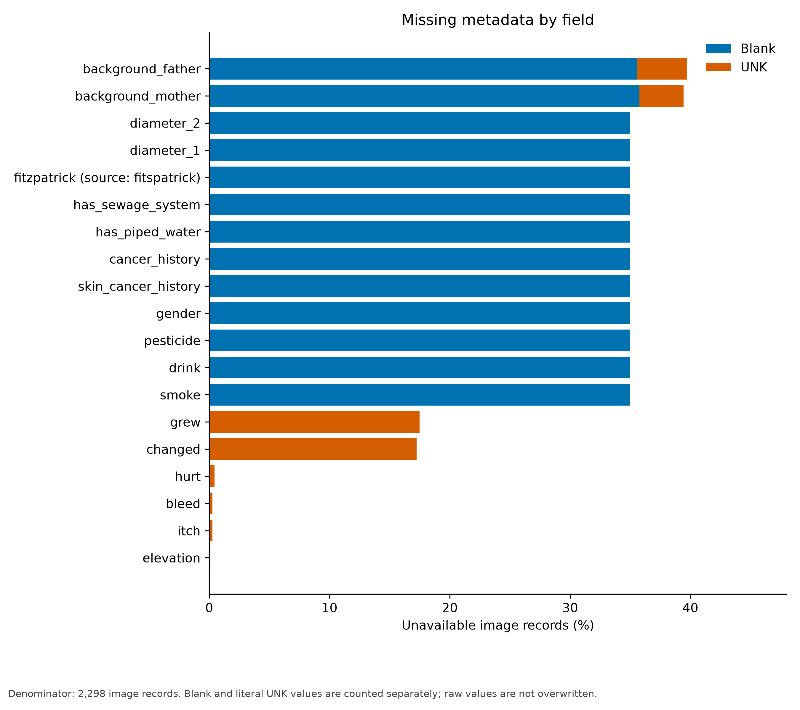
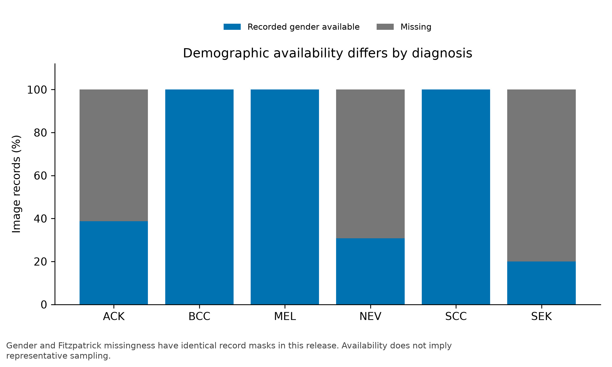

# Phase 2: Metadata Exploration

Analysis date: 19 October 2026. Status: completed metadata audit; image-content checks, data splitting and model experiments are pending.

## Provenance

The CSV was downloaded from the [official PAD-UFES-20 version 1 file page](https://data.mendeley.com/datasets/zr7vgbcyr2/1/files/fa850265-57da-48f0-ba3e-998b3e44b1f6). Its 316,209 bytes match the SHA-256 displayed there:

`14d145235cedb022548257acb0d84dcd949e2c916f65d2baa7c38ed5339e9527`

Direct HTTP requests returned Cloudflare error 1010. A mirror with a different checksum was rejected and never analysed. The accepted file came from the official browser download. Raw data and its detailed retrieval record remain local under ignored `data/raw/`.

These are observed metadata findings, not model results. The [aggregate audit](../results/metadata_audit.json) is generated by `scripts/audit_data.py`; synthetic tests exercise consequential counting and validation rules.

## Analysis units and class support

| Diagnosis | Image records | Patient–lesion pairs | Patients with diagnosis |
|---|---:|---:|---:|
| ACK | 730 | 644 | 525 |
| BCC | 845 | 652 | 513 |
| MEL | 52 | 36 | 36 |
| NEV | 244 | 216 | 185 |
| SCC | 192 | 145 | 133 |
| SEK | 235 | 198 | 176 |

The table contains 2,298 image records, 26 columns and 1,373 distinct patient identifiers. Patients can have several diagnoses, so the patient column must not be summed as a population total.

There are 1,641 distinct `lesion_id` strings but **1,891 distinct `(patient_id, lesion_id)` pairs**. Exactly 250 lesion-ID strings occur under more than one patient. Therefore, the raw lesion ID is not a globally unique key in this CSV. The published count of 1,641 is retained as a documentation reference; 1,891 is the observed pair count, not an independently verified count of biological lesions. The discrepancy needs explicit reporting and source clarification where possible.

No composite pair has conflicting diagnosis values. Image filenames match their metadata patient/lesion prefixes. No duplicate image-ID rows or completely duplicated metadata rows were found. These checks do not establish that image contents are unique or readable: the images have not been downloaded or decoded.

## Patient demographics

| Field | Consistent known patients | Entirely missing | Conflicting | Invalid |
|---|---:|---:|---:|---:|
| Age | 1,283 | 0 | 90 | 0 |
| Recorded gender | 794 | 579 | 0 | 0 |
| Recorded Fitzpatrick type | 794 | 579 | 0 | 0 |

Gender categories among patients with a unique observed value are FEMALE (416) and MALE (378). The label is described as recorded gender; the field does not establish verified biological sex.

Age is populated in every image record, but 90 patients have more than one recorded age across their records. Without visit dates, these disagreements cannot be resolved by assuming longitudinal follow-up. All 90 remain unresolved in the patient-age summaries, even if their ages fall within the same proposed band. Raw ages are not replaced, and these patients are not excluded from overall image-only modelling.

Among the 1,283 patients with a single valid age, median age is 61 years and the interquartile range is 49–71 years. The predefined age groups contain 608 patients under 60 and 675 aged 60 or over; 90 are unresolved.

For Fitzpatrick type, patient counts are I: 74, II: 465, III: 212 and IV: 34. Individual counts for types V and VI are both displayed as `<10`; they are not merged into a new inferential group. A further 579 patients have no recorded type. These marginal suppressions are a publication convention, not a guarantee of anonymisation. Do not publish rare type-by-diagnosis combinations or individual records.

## Missingness and selection

Both recorded gender and Fitzpatrick type are blank for 804 image records, approximately 35.0% of records. Their missingness masks are identical. The patient-level missing count is 579, approximately 42.2% of patients. The difference between these percentages reflects repeated images and lesions.

| Diagnosis | Gender/type available: images | Missing: images |
|---|---:|---:|
| ACK | 283 | 447 |
| BCC | 845 | 0 |
| MEL | 52 | 0 |
| NEV | 75 | 169 |
| SCC | 192 | 0 |
| SEK | 47 | 188 |

All 1,342 biopsy-marked image records have recorded gender. Of the 956 non-biopsy-marked records, 804 lack gender. This is an observed association, not a proven missing-data mechanism. The known-demographic subset has a different diagnostic composition from the entire dataset; a complete-case-only experiment would change the research population substantially.

Other fields contain blank or literal `UNK` entries. The audit counts them separately. It does not impute demographic categories, replace unknown values with zero or discard all incomplete rows.

## Implications for the pilot protocol

1. Keep patient-level separation and use a composite patient–lesion key for aggregation. Do not collapse records across patients using `lesion_id` alone.
2. Keep all otherwise eligible records in the overall image-only study. Report missing-demographic groups and coverage explicitly.
3. Treat conflicting patient ages as unresolved for age subgroup analyses. Do not choose a first, average or majority age without a separately justified amendment.
4. Restrict Fitzpatrick analysis to supported descriptive comparisons. Rare types cannot support strong independent conclusions.
5. The 52 melanoma images represent only 36 patients. A roughly 20% patient test split may contain very few melanoma patients, especially within subgroups. This is a planning implication, not an observed test-split result.
6. The proposed four-way split remains prospective. Confirm achieved independent class and subgroup support after image checks, before training. Missing-class metrics must remain unavailable when necessary.

## Completed and pending

Completed: official-byte verification, schema checks, metadata identifier checks, class and patient support, demographic consistency, missingness analysis, six aggregate figures, reusable audit code and synthetic correctness tests.

Pending: image archive acquisition, filename-to-file matching, readability/content-duplicate checks, actual patient partitioning, model training, probability calibration, model fairness metrics and statistical comparisons. No claim about predictive fairness or model calibration follows from this metadata audit alone.
